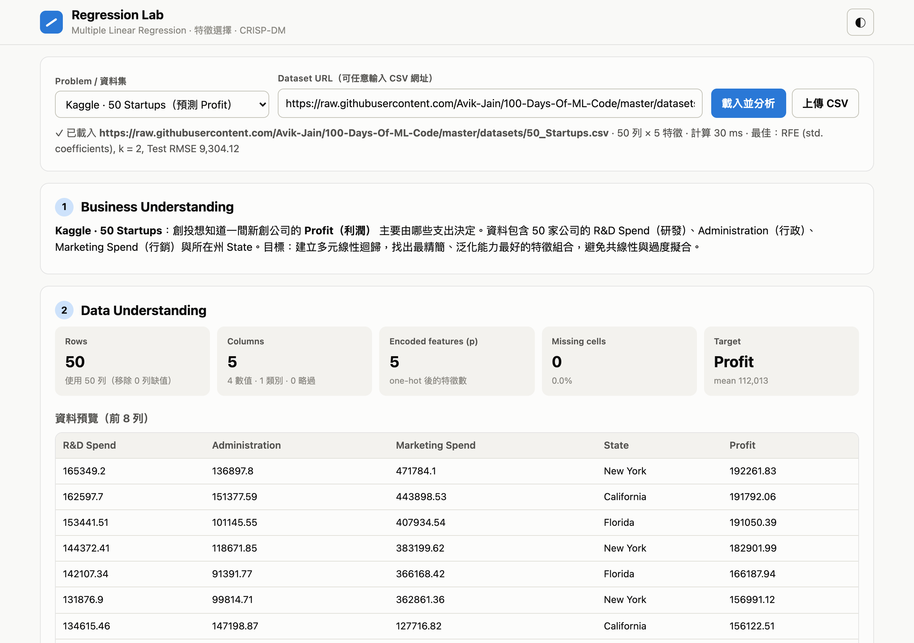
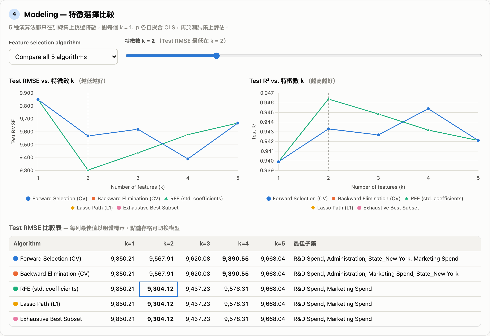
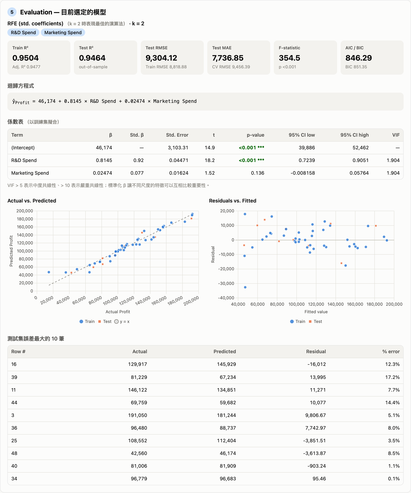

# Regression Lab — Multiple Linear Regression & Feature Selection

用 CRISP-DM 流程分析多元線性迴歸，並比較 5 種特徵選擇演算法。可以用下拉選單切換兩個題目，也可以貼上任何 CSV 網址：

- **Kaggle 50 Startups**：預測 `Profit`
- **Boston Housing**：預測 `medv`（房價中位數，單位千美元）
- **任意 CSV URL**，例如 `https://raw.githubusercontent.com/Avik-Jain/100-Days-Of-ML-Code/master/datasets/50_Startups.csv`（也可以上傳本機 CSV）

## 網頁截圖







## 設計特色

整套統計引擎（`js/stats.js`）以**純 JavaScript 在瀏覽器裡即時計算**，不需要預先算好結果：

- **任意資料集**：兩個預設題目之外，任何公開 CSV URL 或本機上傳都能當場分析（Boston 約 0.3 秒）
- **部署輕量**：Vercel 上是靜態網站，加一個零依賴的 CORS proxy function，不需要 Python 套件
- **參數可調**：目標變數、預測變數、test size、seed、CV folds 都能即時修改

## 功能（CRISP-DM）

1. **Business Understanding**：說明題目與目標
2. **Data Understanding**：資料預覽、敘述統計、缺值數、各特徵與目標的 Pearson r
3. **Data Preparation**：自動判斷欄位型別，類別欄位做 one-hot（drop first，≤ 20 個 level），移除有缺值的列，用 seed 切分 train/test
4. **Modeling**：5 種特徵選擇演算法，每種都產生 k = 1…p 的特徵子集
   - Forward Selection（以 k-fold CV RMSE 挑選）
   - Backward Elimination（以 k-fold CV RMSE 挑選）
   - RFE（遞迴移除標準化係數最小的特徵）
   - Lasso Path（座標下降法，依特徵進入 L1 路徑的先後排序）
   - Exhaustive Best Subset（每個 k 取訓練 SSE 最小的子集，p ≤ 16）
   - 「Test RMSE / R² vs. k」折線圖，以及可點選切換模型的比較表
5. **Evaluation**：R²、Adj. R²、Test RMSE/MAE/R²、CV RMSE、F 檢定、AIC/BIC；係數表含 SE、t、p、95% CI、VIF、標準化 β；Actual vs Predicted、殘差圖、誤差最大的 10 筆
6. **Deployment**：輸入特徵值即時預測，附 95% 預測區間和各項 β·x 貢獻

## 專案結構

```
├── index.html          # 單頁應用
├── css/style.css       # 淺色 / 深色主題、RWD
├── js/stats.js         # OLS、t/F 分佈、VIF、Lasso、5 種特徵選擇（瀏覽器 + Node 共用）
├── js/data.js          # CSV 解析、欄位型別判斷、one-hot 編碼
├── js/app.js           # UI 與 Chart.js 圖表
├── api/proxy.js        # Vercel Serverless Function：處理沒有 CORS 標頭的 CSV 網址
├── docs/              # README 截圖
├── test/run-tests.mjs  # 與 statsmodels 參考值比對的測試
├── vercel.json
└── package.json
```

## 本機執行

```bash
# 只看前端（預設資料集來自 raw.githubusercontent.com，本身支援 CORS）
python3 -m http.server 8000      # 開啟 http://localhost:8000

# 連 /api/proxy 一起跑
vercel dev

# 驗證統計引擎（需要網路）
npm test
```

## 部署到 Vercel

```bash
npm i -g vercel
vercel           # 預覽部署
vercel --prod    # 正式部署
```

或把專案推到 GitHub，在 Vercel 匯入該 repo。Framework Preset 選 **Other**，不需要 build command。

## 正確性驗證

`npm test` 用全部樣本擬合，把結果和 statsmodels 的參考值比對：

| 資料集 | 指標 | 本專案 | 參考值 |
|---|---|---|---|
| 50 Startups | R² / Adj. R² | 0.9508 / 0.9452 | 0.951 / 0.945 |
| 50 Startups | β(R&D Spend) | 0.8060 | 0.8060 |
| 50 Startups | F | 169.9 | 169.9 |
| Boston | R² / Adj. R² | 0.7406 / 0.7338 | 0.741 / 0.734 |
| Boston | Intercept | 36.4595 | 36.4595 |
| Boston | VIF(tax) | 9.009 | 9.009 |

用 seed 42、test size 20% 時，50 Startups 有 3 種演算法（RFE、Lasso、Exhaustive）挑到同一組 **k = 2：R&D Spend + Marketing Spend**，Test R² 0.946。
